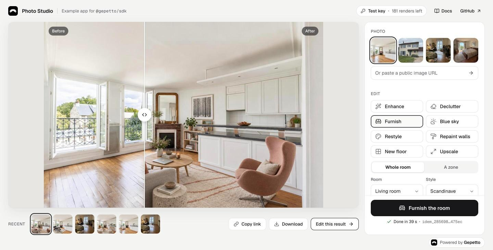

# Photo Studio: a Next.js example of the Gepetto API

[](https://www.npmjs.com/package/@gepetto/sdk)

A real estate photo studio in one page, built with [`@gepetto/sdk`](https://www.npmjs.com/package/@gepetto/sdk): pick a photo, pick a tool, get the image. Enhance, declutter (the whole room, or only what you paint), furnish (the whole room, or a painted zone), blue sky, restyle, repaint the walls, change the floor, upscale.

Clone it to see how the API fits in an app, or start your product from it: the design is neutral on purpose.



## Run it

```bash
git clone https://github.com/Gepetto-AI/gepetto-nextjs-starter.git
cd gepetto-nextjs-starter
npm install
npx @gepetto/cli login   # opens a page: check the code, click "Authorize"
npx @gepetto/cli init    # writes a free test key (200 real renders) to .env
npm run dev
```

Open http://localhost:3000. The first render is one click away: the sample living room, "Furnish", "Furnish the room".

Already have a key? Put it in `.env` as `GEPETTO_API_KEY` (see `.env.example`).

## How it works

The page never sees the API key. It calls the app's own routes, which call Gepetto with the SDK.

What happens when you click the main button:

1. [`components/studio.tsx`](components/studio.tsx), `makeImage()`: turns the painted zone into a mask, if the tool uses one.
2. [`lib/sdk-calls.ts`](lib/sdk-calls.ts): builds the SDK call for the tool and your choices. **Start here**: every tool is there, as one call.
3. [`lib/studio-api.ts`](lib/studio-api.ts): sends it to the server, with a new idempotency key.
4. [`app/api/render/route.ts`](app/api/render/route.ts) and [`lib/render.ts`](lib/render.ts): the server makes the call with `@gepetto/sdk` and answers when the image is ready.
5. Back in `makeImage()`: the result is shown next to the photo.

The other files:

| File | What it does |
| --- | --- |
| [`lib/tools.ts`](lib/tools.ts) | The eight tools and everything the panel lets you choose |
| [`lib/gepetto.ts`](lib/gepetto.ts) | The client, the lists of ids (rooms, styles, skies...), the account, the latest renders |
| [`app/api/bootstrap/route.ts`](app/api/bootstrap/route.ts) | What the page needs to start |
| [`app/api/upload/route.ts`](app/api/upload/route.ts) | Your own photos (optional, see below) |
| [`components/painter.tsx`](components/painter.tsx) | Paint a zone, turned into a mask |
| [`components/`](components) | The rest of the studio: one file per part of the screen |

A few things worth copying:

- **Each click sends its own idempotency key**: a retry of the same click never renders, nor bills, twice.
- **Masks are sent in base64.** What you paint becomes a black and white PNG (`canvas.toDataURL('image/png')`, a few dozen KB), sent with the request: nothing to host.
- **The ids come from the API** (`GET /rooms`, `/styles`...), cached for an hour, so new rooms and styles show up by themselves.
- **"The SDK call"** in the panel shows the exact call the server makes for the current choices.

## Your own photos

Gepetto takes photos by URL: upload them to your own storage first, then give the public URL. Out of the box, the studio works with its sample photos and with any public image URL you paste.

To let people upload their photos, connect a [Vercel Blob](https://vercel.com/docs/vercel-blob) store and set `BLOB_READ_WRITE_TOKEN`: an "Upload" tile appears, and you can drop a photo on the page. The browser sends the file straight to your store, and the studio gives its public URL to Gepetto. Another storage (S3, R2, Supabase...) works the same way: replace [`app/api/upload/route.ts`](app/api/upload/route.ts) with an upload that returns a public URL.

## Deploy

The render route waits for the image, usually 15 to 90 seconds: `maxDuration` is set to 300 s, the most a Vercel Hobby function can last. A longer render is not lost: it appears in Recent once done.

**Before you put it online:** anyone who can open the app can make renders with your key (and upload to your storage). Keep the test key, or add your own sign-in first.

## About Gepetto

Gepetto is the AI photo studio for real estate professionals. From a single photo, it furnishes an empty room, empties a cluttered one, restyles an interior, replaces a grey sky, repaints walls, changes floors, enhances the picture and animates the property on video, in seconds and with no technical skill. Launched in January 2023 in Bordeaux, France, Gepetto is used by more than 1,000 agencies, networks and real estate photographers, on the web, on iPhone and Android, and through its API inside real estate CRMs and platforms.

[gepettoapp.com](https://gepettoapp.com) · [API documentation](https://docs.gepettoapp.com) · [SDK](https://github.com/Gepetto-AI/gepetto-sdk) · [CLI](https://github.com/Gepetto-AI/gepetto-cli)

## License

MIT
